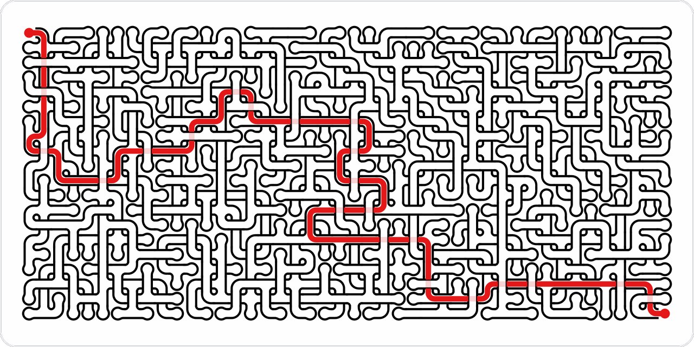

<h1 align="center">maze</h1>

<p align="center">Weave mazes, generated in Python, as SVG, PDF or text.</p>

<p align="center">
  <a href="https://maze.do.id.au/?maze=straight"><b>Play</b></a> &nbsp;·&nbsp;
  <a href="#quick-start">Quick start</a> &nbsp;·&nbsp;
  <a href="#documents">Documents</a> &nbsp;·&nbsp;
  <a href="#how-it-works">How it works</a>
</p>

<p align="center">
  
</p>

maze makes **weave mazes**: mazes whose passages cross over and under each
other. It writes them as SVG, PDF or plain text, with an optional solution. For
something faster, with a hand-drawn look and more styles, see its Rust port,
[maze-rs](https://github.com/daleobrien/maze-rs). Play them in the browser at
[maze.do.id.au](https://maze.do.id.au/?maze=straight).

## Quick start

```bash
pip3 install maze
maze svg maze.svg -s maze-solved.svg -W 23 -H 30   # a maze and its solution
maze pdf my_maze.pdf                               # an A4 page
maze text -W 20 -H 10                              # to the terminal
maze                                               # every option
```

The same maze id (`-i`) always gives the same maze. See
[Using maze](https://github.com/daleobrien/maze/blob/master/docs/usage.md) for
the options and examples.

## Documents

| Document | What's in it |
| -------- | ------------ |
| [Using maze](https://github.com/daleobrien/maze/blob/master/docs/usage.md) | Installing, making mazes, every option, and examples with and without curves |
| [How it works](https://github.com/daleobrien/maze/blob/master/docs/how-it-works.md) | The weave algorithm, the code, and the Rust version |

## How it works

The grid is first decorated with the over-and-under crossings, then Kruskal's
algorithm joins the cells into one maze, a technique described by Robin
Houston. `maze/maze.py` makes and solves the maze, and `maze/renderers/` draws
it as SVG, PDF or text. [How it works](https://github.com/daleobrien/maze/blob/master/docs/how-it-works.md)
has more.

---

<p align="center"><sub>Part of <a href="https://daleobrien.github.io/#mazes">Mazes</a> &nbsp;·&nbsp; more at <a href="https://daleobrien.github.io">daleobrien.github.io</a></sub></p>
