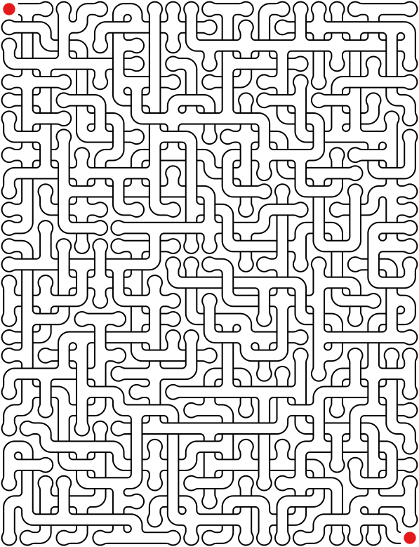
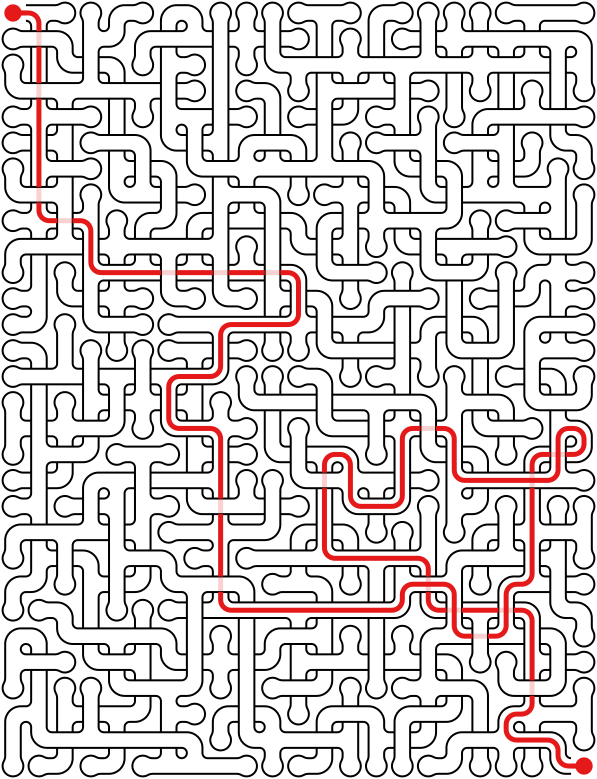
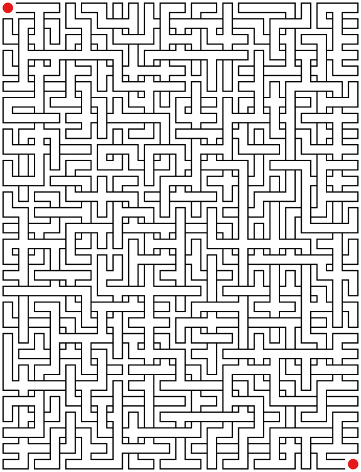
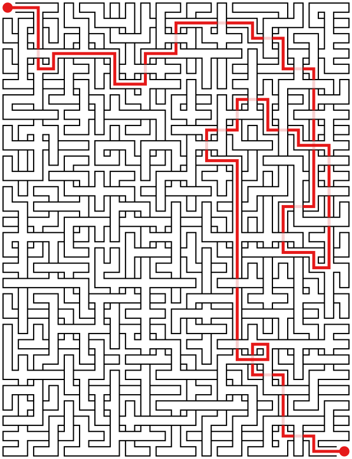

# Using maze

[Back to the README](../README.md)

## Installing

```bash
pip3 install maze
```

Or from source, in a clone of this repository:

```bash
python3 setup.py install
```

To run it without installing, change into the directory with `maze.py` and
use `python3 maze.py` in place of `maze`.

## Making a maze

```bash
maze svg maze.svg -s maze-solved.svg -W 23 -H 30   # a maze and its solution
maze svg maze-straight.svg -s maze-straight-solved.svg -W 23 -H 30 -S
maze pdf my_maze.pdf                               # an A4 page
maze text -W 20 -H 10                              # to the terminal
```

Run `maze` without any arguments to see every option. The first command gives:

| maze.svg | maze-solved.svg |
| -------- | --------------- |
|  |  |

and with `-S`, straight lines instead of curves:

| maze-straight.svg | maze-straight-solved.svg |
| ----------------- | ------------------------ |
|  |  |

## Options

| Option | Meaning | Default |
| ------ | ------- | ------- |
| `-W`, `--width` | Number of cells wide | 21 |
| `-H`, `--height` | Number of cells high | 30 |
| `-d`, `--density` | Density of crossings (unders and overs) | 50 |
| `-L` | Allow a loop | off |
| `-S` | Straight lines instead of curves (`svg`, `pdf`) | off |
| `-p` | Page size, `A4` or `Letter` | A4 |
| `-O`, `--orientation` | `P` portrait or `L` landscape (`pdf`) | P |
| `-i`, `--maze_id` | Which maze: the same id always gives the same maze | a random maze |
| `-s`, `--solution` | Also write the solution to this file (`svg`) | none |

The PDF can't have a solution yet: use `svg` for that.
